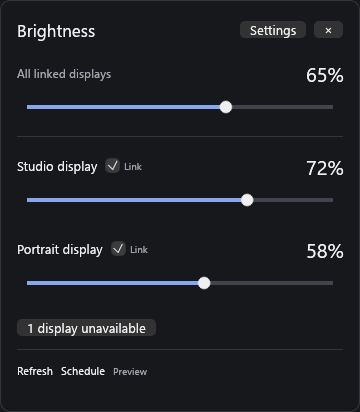
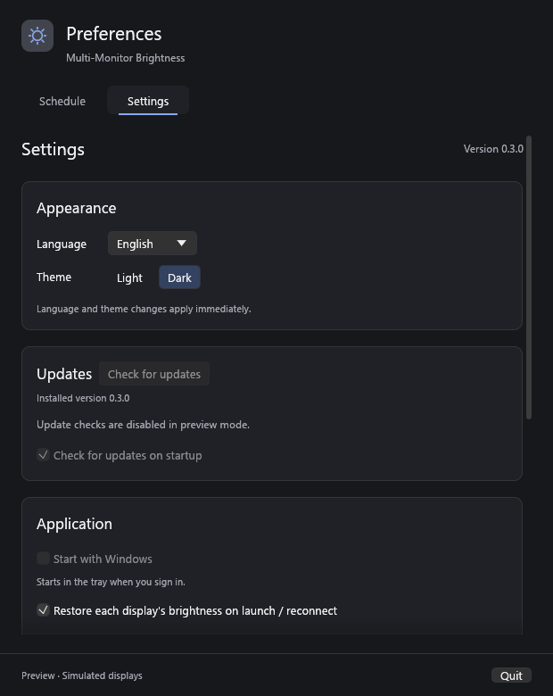
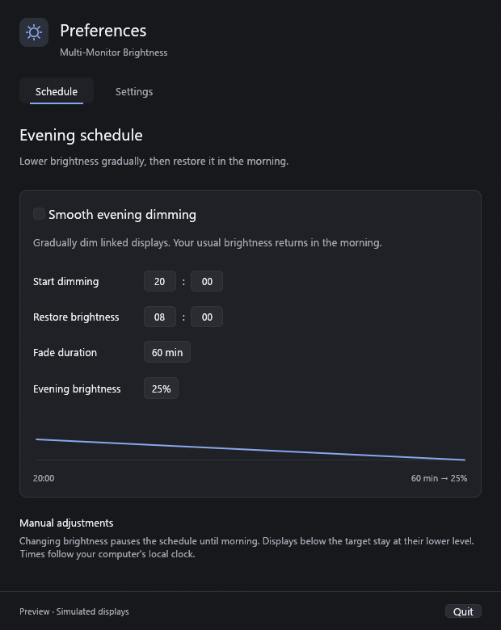

# Multi-Monitor Brightness

*Brightness control without leaving the keyboard.*

An unobtrusive Windows utility for controlling external monitor brightness from the keyboard. Built in Rust, with a native desktop interface and a single executable. No installer, WebView, or .NET runtime required.

## Download

Download [**MultiMonitorBrightness-v0.2.3.exe**](https://github.com/siarheisinelnikau/multi-monitor-brightness/releases/download/v0.2.3/MultiMonitorBrightness-v0.2.3.exe) from the [latest release](https://github.com/siarheisinelnikau/multi-monitor-brightness/releases/latest). Windows 10/11 x64; no installer or additional runtime required. Save it in a writable folder and run it.

**Upgrading from 0.2.0:** download the latest release manually, quit the old app from the tray, and replace your previous executable. Version 0.2.0 expects the old download name and cannot install releases that use versioned filenames. Normal AppData settings are kept. For portable mode, keep the existing `multi-monitor-brightness.json` beside the executable and launch with `--portable`. If you change the installed filename, update **Settings → Application → Use this executable** when Windows startup is enabled. From 0.2.1 onward, in-app updates support the versioned release names and preserve the installed filename and startup path.

## Screenshots

Actual application screenshots captured in preview mode with simulated monitors. Preview mode does not change physical monitor brightness or saved preferences.

**Brightness popup:** click the tray icon to adjust linked displays or each monitor separately.



**Settings:** installed version, update checks, Windows startup, and keyboard shortcuts.



**Schedule:** configure evening dimming and morning brightness restoration.



## Features

- CPU rendering with Windows GDI presentation; no OpenGL or DirectX rendering backend.
- Reactive rendering: hidden windows skip painting, unchanged scenes keep their cached bitmap.
- A shared slider for all linked displays, plus an individual slider for each screen.
- Global, customizable brightness shortcuts. Relative changes preserve differences between displays.
- Smooth evening dimming with configurable start time, duration, target, and morning restoration.
- Per-monitor brightness memory, restored on launch and reconnection.
- A compact brightness popup next to the tray icon: click, adjust, and dismiss.
- A separate preferences window for Settings and Schedule.
- GitHub update checks and in-app download, verification, replacement, and restart.
- Optional Windows autostart, launching quietly in the tray, and the app version in Settings.
- Background DDC/CI operations, throttled writes, and automatic display topology detection.
- A demo mode with simulated monitors, isolated from real brightness and saved preferences.

## Run

An ordinary launch controls your real monitors. **Preview** appears only when explicitly launched with `--demo`, which uses simulated displays. Exit the preview and run the executable without arguments to use real hardware.

Launch `MultiMonitorBrightness-v0.2.3.exe`. Enable **DDC/CI** in your external monitor's on-screen menu if the display reports that brightness control is unavailable.

| Shortcut | Action |
| --- | --- |
| `Ctrl + Alt + Up` | Increase linked displays by 5 percentage points |
| `Ctrl + Alt + Down` | Decrease linked displays by 5 percentage points |
| `Ctrl + Alt + B` | Open the brightness popup |

Change the shortcuts and step size in **Settings → Apply shortcuts**. Windows reports conflicts with other applications in the same panel.

The shared slider sets linked displays to the same percentage; hotkeys and the tray's +/- actions adjust each linked display relative to its current level. Clear **Link** to exclude a monitor from shared controls and the evening schedule. Its individual slider remains available.

Click the tray icon to toggle the brightness popup. Press **Esc** or click outside it to dismiss. Open **Settings** or **Schedule** from the popup or the tray context menu. Closing preferences keeps the utility running in the tray. Use **Quit** in the preferences footer or tray menu to exit.

```powershell
.\MultiMonitorBrightness-v0.2.3.exe --demo
.\MultiMonitorBrightness-v0.2.3.exe --portable
.\MultiMonitorBrightness-v0.2.3.exe --settings
```

Normally, settings live in `%APPDATA%\MultiMonitorBrightness\settings.json`. `--portable` stores `multi-monitor-brightness.json` beside the executable instead. The executable is self-contained; the JSON file holds your preferences. Demo mode neither reads nor writes these settings and does not register global shortcuts.

## Windows startup

Enable **Start with Windows** in **Settings → Application**. This registers the current executable for your Windows account; administrator rights are not needed. Startup is off until you opt in. The app starts quietly in the tray when you sign in. The option also preserves `--portable` when enabled from a portable session.

Keep the executable in a stable folder. If you move it, open Settings and select **Use this executable** to update its startup location. Disable **Start with Windows** before removing the app. The registration lives in the current user's Windows Run key, rather than in the JSON preferences. Windows may delay startup apps or disable them through its own Startup Apps settings.

The version is always visible at the top of Settings and comes directly from Cargo package metadata.

## Updates

Open **Settings → Updates → Check for updates**, or use the tray context menu. The app checks the latest stable release from this repository; a background check runs shortly after each launch by default. Disable **Check for updates on startup** to prevent startup update requests; manual checks remain available. Downloads and installation always require clicking **Download and install**.

The app downloads the single Windows x64 executable and `SHA256SUMS.txt` over HTTPS, verifies the size, SHA-256, and Windows executable format, then finishes pending brightness changes and saves preferences. A helper waits for the current process to exit, replaces the executable with a recoverable backup, and restarts into Settings. The previous executable is removed after the new app initializes. Preferences, portable mode, and the existing autostart path are preserved.

The executable's folder must be writable. If an update cannot be downloaded or verified, the installed executable is left intact and Settings shows the error. No installer or administrator rights are required for a copy stored in your user folder.

## Evening dimming

Enable the schedule in **Schedule**. By default, brightness fades from each screen's remembered manual level toward 25%, starting at 20:00 over 60 minutes. At 08:00, the remembered levels return. Screens already below the target never get brighter during dimming.

Changing brightness manually pauses the schedule for the current evening. Use **Resume** to re-enable it immediately. Schedule output does not overwrite the remembered manual brightness. Times use the computer's local clock, including changes to time zone or daylight saving time. The app must be running for schedules and hotkeys to work; Enable **Settings → Start with Windows** to keep it available after signing in.

## Compatibility

- Windows 10/11, x86-64. The application draws on the CPU and presents through Windows GDI. Internet access is needed only for update checks/downloads.
- External displays that expose brightness through DDC/CI. The backend uses `GetMonitorBrightness` / `SetMonitorBrightness`, with a VCP `0x10` fallback.
- Built-in laptop panels, displays with DDC/CI disabled, and some docks, KVMs, or adapters may be unavailable. There is no software overlay or WMI fallback.
- Monitor preferences are keyed by the Windows monitor interface path, with a display-path fallback. Moving a display to a different port or adapter can create a new identity. Mirrored displays may expose ambiguous identities.
- Driver and monitor implementations vary. Physical brightness changes require validation on your hardware.

## Build from source

Install Rust (stable, MSVC toolchain) and Visual Studio Build Tools with **Desktop development with C++** and a Windows SDK. Rust 1.95 or newer is required.

```powershell
cargo run -- --demo
cargo fmt --check
cargo clippy --locked --all-targets -- -D warnings
cargo test --locked
.\scripts\build.ps1
```

The build script reads the package version and creates `dist\MultiMonitorBrightness-vVERSION.exe` and `dist\SHA256SUMS.txt`, with the same versioned filename in the checksum. Only one architecture is offered, so the executable has no architecture suffix. `.cargo/config.toml` statically links the MSVC runtime. The icon, manifest, and default fonts are embedded. Only standard Windows and graphics-driver DLLs are needed at runtime.

CI runs formatting, Clippy, tests, and a release build on Windows, then uploads the executable as a build artifact. CI and release builds use the tested Rust 1.96.1 toolchain.

Optional read-only hardware check (requires a live desktop): `cargo test read_hardware_brightness -- --ignored --nocapture`.

## Implementation

`src/monitors.rs` owns all physical monitor handles on a dedicated worker thread and releases them on refresh or shutdown. Writes are coalesced per monitor, and revision numbers keep delayed results from overwriting newer slider positions. Failed changes leave the last successful manual brightness intact. A separate thread registers and receives Win32 global hotkeys; egui handles the window and tray actions.

`src/host.rs` hosts egui with winit, CPU rasterization, and Windows GDI bitmap presentation. The Windows dependency tree contains no eframe, OpenGL, glutin, or wgpu renderer. Tray commands, hotkeys, monitor responses, saving, and schedules run independently of visible painting. Hidden windows do not rasterize; unchanged visible scenes skip rasterization and presentation. Windows expose events restore the retained bitmap. Pointer and repaint bursts coalesce to the current monitor's refresh period (60 Hz fallback when unavailable). The event loop waits for input or scheduled work rather than polling continuously.

Font and image uploads from hidden UI passes remain pending until the next visible paint. The shared CPU renderer retains its textures across the separate brightness and preferences windows. The vendored rasterizer's original license files are in `vendor/egui_software_backend`; binary notices are in `THIRD_PARTY_NOTICES.txt`.

Settings are written to a same-directory temporary file, synced, then replaced. An unreadable settings file is preserved and automatic saving is paused until it is fixed or moved. The evening scheduler derives its output from manual levels rather than progressively modifying its own previous output.

## Status

Current version: 0.2.3. Automated tests cover brightness scaling, schedule boundaries, shortcut validation, persistence, queued monitor operations, popup placement, release selection, and update verification. Hardware compatibility is not yet certified.

Live-window regression checks the brightness popup, separate preferences, reopening and minimizing windows, hidden brightness commands, background dimming/restoration, and Quit. Run `scripts\test-tray.ps1` and `scripts\test-tray.ps1 -Startup` on an interactive Windows desktop. The checks use simulated monitors and the installed menu callback, without injecting mouse/keyboard input or changing physical brightness.

Run `scripts\test-updater.ps1` for a native update regression using an isolated copy in `target`: it waits for a running executable to exit, replaces it, checks the backup, restarts the new copy, and cleans up its own fixture. CI runs this regression too. The optional network check `cargo test public_release_download_verifies -- --ignored --nocapture` downloads and verifies the latest public release without installing or executing it.

For a release-mode CPU renderer regression on an interactive Windows desktop, run `scripts\test-renderer.ps1`. It uses three seconds of warm-up and five seconds of measurement for Settings, the brightness popup, hidden startup, and a simulated slider drag. Native pointer input is ignored only in this opt-in benchmark, so desktop activity does not contaminate the idle workload. It verifies zero idle rasterizations, zero hidden paints, changing slider frames, and absence of OpenGL/DirectX modules. JSON results stay in `dist/render-tests`. This is a controlled input test; it does not establish subjective mouse latency on every machine.

## Short description

Keyboard-first brightness control for external monitors, with customizable hotkeys, a shared slider, smooth evening dimming, and per-monitor settings.

## License

MIT. See [LICENSE](LICENSE).

API references: [Windows monitor configuration](https://learn.microsoft.com/en-us/windows/win32/monitor/using-the-low-level-monitor-configuration-functions), [global hotkeys](https://learn.microsoft.com/en-us/windows/win32/api/winuser/nf-winuser-registerhotkey), [egui-winit](https://docs.rs/egui-winit/0.37.0/egui_winit/), and [softbuffer](https://docs.rs/softbuffer/0.4.8/softbuffer/).
